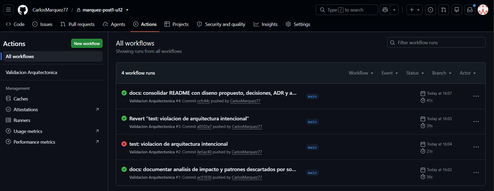
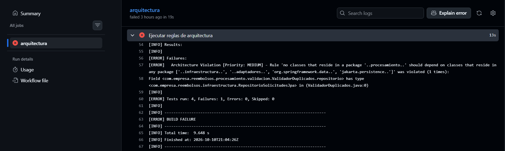

# Reembolsos Integrado — Proyecto integrador

Post-contenido de la Unidad 12 de Patrones de Diseño de Software.
Sistema para registrar, validar, calcular y notificar solicitudes de
reembolso de gastos del área de Finanzas, construido como un único
proyecto Spring Boot (`reembolsos-integrado`).

## Diseño Propuesto

Esta sección se escribió antes de implementar los patrones. Para cada
requisito se identifica qué es lo que varía, qué patrón lo resuelve y
por qué ese y no otro.

### RF1 — Validación en varias etapas
- **Qué varía.** Cuántas verificaciones debe pasar una solicitud y
  cuáles son. Hoy son tres (tope por categoría, documentos soporte,
  duplicados) y Finanzas ya anunció una cuarta, el límite anual
  acumulado por empleado. Cada una puede rechazar por su cuenta, con
  su propio motivo.
- **Patrón: Chain of Responsibility.**
- **Justificación en una oración.** Cada verificación es un eslabón
  independiente que rechaza la solicitud o la pasa al siguiente, de
  modo que agregar una verificación es agregar un eslabón sin tocar
  los que ya existen.
- **Por qué no otro.** Tres `if` seguidos dentro del servicio
  funcionan hoy, pero cada verificación nueva obliga a modificar el
  servicio y a volver a probarlo, que es lo que el requisito pide
  evitar. Decorator tampoco encaja: no se le agrega comportamiento a
  la solicitud, se decide si continúa o se detiene.

### RF2 — Cálculo distinto por categoría de gasto
- **Qué varía.** La fórmula del monto aprobado: una por categoría
  (viáticos, representación, capacitación), con más categorías
  anunciadas ("bienestar"). La categoría se conoce al crear la
  solicitud y no cambia después.
- **Patrón: Strategy.**
- **Justificación en una oración.** Cada categoría es un algoritmo
  intercambiable con la misma entrada y la misma salida, así que una
  categoría nueva es una clase nueva y las fórmulas existentes no se
  tocan.
- **Por qué no otro.** Un `switch` sobre `CategoriaGasto` obliga a
  editar el mismo método con cada categoría. State no aplica porque
  la solicitud no cambia de categoría ni hay transiciones. Tampoco
  hace falta una Factory propia: las calculadoras las crea el
  contenedor de Spring, y elegir la correcta es una búsqueda en un
  mapa, no un problema de creación.

### RF3 — Notificación simultánea a varios interesados
- **Qué varía.** Quiénes se enteran de un cambio de estado y qué hace
  cada uno. Hoy son tres con reacciones distintas (empleado,
  Contabilidad solo en aprobaciones, auditoría siempre) y Finanzas ya
  mencionó un cuarto, el panel de métricas.
- **Patrón: Observer.**
- **Justificación en una oración.** El servicio que cambia el estado
  avisa a una lista de interesados sin conocer cuántos son ni qué
  hace cada uno, y sumar un interesado no modifica ni al servicio ni a
  los demás.
- **Por qué no otro.** Llamar a los tres desde el servicio lo acopla
  a cada interesado y lo obliga a cambiar con cada uno nuevo. Chain of
  Responsibility sería un error aquí: en una cadena un eslabón puede
  cortar el flujo, y en este requisito todos deben enterarse siempre.

### Por qué tres patrones y no más
Cada patrón resuelve un problema que los otros dos no resuelven:
decidir si la solicitud continúa (RF1), con qué fórmula se calcula
(RF2) y quién se entera (RF3). En los tres casos la variación está
escrita en el requisito, no supuesta. `SolicitudReembolsoService`
coordina los tres y es el único punto de entrada para el controlador,
pero no se cuenta como un cuarto patrón agregado: es el servicio de
aplicación que existiría de todas formas.

| Requisito | Qué varía | Patrón | Paquete |
|-----------|-----------|--------|---------|
| RF1 | Las verificaciones previas a la aprobación | Chain of Responsibility | `procesamiento.validacion` |
| RF2 | La fórmula del monto aprobado | Strategy | `procesamiento.calculo` |
| RF3 | Los interesados en un cambio de estado | Observer | `procesamiento.notificacion` |

## Decisiones de diseño

### Decisión 1 — Orden de la cadena: documentos, monto, duplicados
El eslabón más caro va al final.

| Eslabón | Qué hace | Costo |
|---------|----------|-------|
| `ValidadorDocumentosSoporte` | Lee un booleano de la solicitud | Constante |
| `ValidadorMontoMaximo` | Busca el tope en un mapa y compara | Constante |
| `ValidadorDuplicados` | Recorre las solicitudes pendientes del empleado | Crece con la lista |

- **Qué se gana.** Una solicitud que falla por algo evidente (sin
  documentos o por encima del tope) se rechaza sin recorrer la lista
  de pendientes. Si duplicados fuera primero, todas las solicitudes
  pagarían ese recorrido, incluidas las que iban a fallar por un
  booleano.
- **Qué se pierde.** El empleado solo ve el primer motivo. Si a la
  solicitud le faltan documentos y además está duplicada, corrige los
  documentos y recién entonces se entera del duplicado.
  `CadenaValidadoresTest` deja fijo ese comportamiento.
- **Límite de la ganancia.** `SolicitudReembolsoService.crear()`
  consulta las pendientes en la base de datos antes de llamar a la
  cadena, así que esa consulta se paga siempre; el orden solo ahorra
  el recorrido en memoria. Para ahorrar también la consulta habría que
  entregar la lista de forma diferida, lo que cambia la firma de los
  validadores y hoy no se justifica: un empleado tiene pocas
  solicitudes pendientes.

### Decisión 2 — Selección de la calculadora con un mapa armado por Spring
`SelectorCalculadora` recibe la `List<CalculadoraReembolso>` que
Spring inyecta con todos los `@Component` y arma un mapa por
categoría. Se descartó un `switch` sobre `CategoriaGasto`.

- **Frente al RF2.** Para agregar "bienestar" se crea
  `CalculadoraBienestar` con `@Component` y el selector, el servicio y
  las tres calculadoras existentes no cambian. Con el `switch` habría
  que editar el selector con cada categoría, que es justo lo que el
  requisito pide evitar, y si se olvida la rama el error aparece en
  ejecución.
- **Qué controla el mapa.** Dos calculadoras con la misma categoría
  hacen fallar `Collectors.toMap` al arrancar, no en la primera
  solicitud. Una categoría sin calculadora termina en
  `IllegalArgumentException("Categoria no soportada")`, cubierto por
  `SelectorCalculadoraTest`.
- **Costo.** La selección deja de estar escrita en un solo lugar: para
  saber qué categorías están soportadas hay que buscar las
  implementaciones de la interfaz.
- **No es una Factory.** El selector no crea nada; las calculadoras
  las construye el contenedor. Por eso no se agregó un Factory Method
  propio encima de la inyección de dependencias.

### Decisión 3 — Capas simples para la persistencia (resumen de ADR-001)
El detalle completo está en [docs/adr/ADR-001.md](docs/adr/ADR-001.md).

- **Persistencia: no se introduce un puerto.**
  `SolicitudReembolsoService` sigue dependiendo de
  `RepositorioSolicitudesJpa`. El criterio de la guía (sección 6.2)
  pide un sistema que vaya a vivir tres años o más con cambios de
  infraestructura, y aquí no hay ningún plan de cambiar de motor. El
  repositorio se usa en una sola clase y con tres métodos, y las
  reglas de negocio ya se prueban sin base de datos porque están en
  `procesamiento`. Un puerto hoy tendría un solo implementador.
- **Notificación: no se cambia nada.** Aquí sí hay un cambio con
  fecha (la API de Contabilidad el próximo trimestre), pero
  `ObservadorCambioEstado` ya es el punto de extensión: basta cambiar
  el cuerpo de `NotificadorContabilidad`.
- **Costo aceptado.** Si se cambia de motor habrá que introducir el
  puerto después, y cuando Contabilidad sea una llamada externa habrá
  que revisar que los observadores se ejecutan uno tras otro dentro de
  la misma petición.

### Decisión 4 — La Regla 1 prohíbe Spring Data y JPA, no todo Spring
La regla existe para garantizar que validar, calcular y notificar se
puedan ejecutar sin base de datos y sin capa web. Por eso distingue
dos tipos de dependencia:

- **`@Component` es una etiqueta.** No cambia lo que hace la clase ni
  lo que necesita para funcionar: las 30 pruebas unitarias de
  `procesamiento` crean los validadores y las calculadoras con `new`,
  sin Spring. En cambio, depender de `JpaRepository` o de una clase
  web sí cambia lo que la clase necesita para ejecutarse.
- **Prohibir todo `org.springframework` rompería RF2 y RF3.** Sin
  estereotipos, los once componentes de `procesamiento` habría que
  declararlos a mano en una clase de configuración, y cada calculadora
  u observador nuevo obligaría a editarla. La inyección de
  `List<CalculadoraReembolso>` y `List<ObservadorCambioEstado>`, que
  es lo que permite agregar sin modificar, depende de que Spring
  encuentre esos `@Component`.
- **Costo aceptado.** `procesamiento` no es Java puro: necesita
  `spring-context` para compilar y no se puede llevar tal cual a un
  proyecto sin Spring. Se acepta porque lo que la regla protege es la
  dirección de las dependencias hacia persistencia y web, no la
  independencia total del framework.

## Qué se descartó y por qué
Las cinco ideas siguientes aparecieron durante el diseño y no se
implementaron. Ninguna es un descarte definitivo: cada una indica qué
señal haría reconsiderarla.

### 1. Patrón State para `EstadoSolicitud` (propio)
- **Qué se consideró.** Una clase por estado (pendiente, aprobada,
  rechazada, requiere corrección) que decidiera a qué estados se puede
  pasar. Parecía encajar porque hay cuatro estados y un método
  `cambiarEstado`.
- **Por qué se descartó.** Ningún requisito define transiciones
  prohibidas ni un comportamiento distinto según el estado. No pasa el
  test de explicabilidad: no se puede decir en una oración qué
  problema de hoy resuelve. Serían cuatro clases para reglas que
  todavía no existen (YAGNI).
- **Qué haría reconsiderarlo.** Que Finanzas defina la primera regla
  de transición, por ejemplo que una solicitud rechazada no pueda
  aprobarse sin pasar por corrección. Con una o dos reglas alcanza una
  validación en el servicio; cuando cada estado tenga comportamiento
  propio, State.

### 2. Topes configurables en lugar de constantes (propio)
- **Qué se consideró.** Sacar los topes (150.000, 2.000.000,
  3.000.000) a `application.properties` o a una tabla, para cambiarlos
  sin recompilar. Era tentador porque el mismo valor aparece en
  `ValidadorMontoMaximo` y en las calculadoras.
- **Por qué se descartó.** No hay ningún requisito de cambiar topes
  sin desplegar y no ha habido ni un solo cambio de tope. La Rule of
  Three pide esperar a la tercera repetición antes de abstraer; aquí
  no hay ni la primera.
- **Qué haría reconsiderarlo.** Un segundo cambio de tope en un mismo
  semestre, o que Finanzas pida ajustarlos sin depender de
  desarrollo.

### 3. Una excepción por cada validador (propio)
- **Qué se consideró.** `DocumentosFaltantesException`,
  `MontoExcedidoException` y `SolicitudDuplicadaException` en lugar de
  una sola `SolicitudInvalidaException` con el motivo como texto.
- **Por qué se descartó.** Los tres rechazos se tratan igual: el
  controlador responde 422 con el motivo. Tres clases que nadie
  distingue no aportan nada, y cada validador nuevo obligaría a crear
  otra excepción y a tocar el manejador de errores.
- **Qué haría reconsiderarlo.** Que algún rechazo necesite un trato
  distinto, por ejemplo otro código HTTP o un reintento automático.

### 4. `ApplicationEventPublisher` en lugar de la lista de observadores (referencia del enunciado)
- **Qué se consideró.** Publicar un evento de dominio y reaccionar con
  `@EventListener`.
- **Por qué se descartó.** Con tres observadores conocidos en tiempo
  de compilación, la interfaz `ObservadorCambioEstado` ya desacopla al
  servicio. Un bus de eventos agrega una indirección más y hace más
  difícil encontrar en el código quién reacciona a qué.
- **Qué haría reconsiderarlo.** Que los interesados deban ejecutarse
  de forma asíncrona o después de confirmar la transacción, algo que
  puede pasar con la integración de Contabilidad.

### 5. Exportadores en varios formatos con Visitor o Abstract Factory (referencia del enunciado)
- **Qué se consideró.** Preparar una jerarquía de exportadores para
  PDF y Excel además de CSV.
- **Por qué se descartó.** Hoy solo existe el requisito de CSV. No se
  cumple la Rule of Three: no hay una segunda solicitud real de otro
  formato.
- **Qué haría reconsiderarlo.** Una segunda petición concreta de
  formato por parte de Contabilidad.

## Arquitectura resultante

```
src/main/java/com/empresa/reembolsos/
├── dominio/                    SolicitudReembolso, CategoriaGasto, EstadoSolicitud (Java puro)
├── procesamiento/
│   ├── validacion/             Chain of Responsibility: ValidadorSolicitud y tres eslabones
│   ├── calculo/                Strategy: CalculadoraReembolso, tres calculadoras y el selector
│   └── notificacion/           Observer: ObservadorCambioEstado y tres notificadores
├── aplicacion/                 SolicitudReembolsoService coordina los tres patrones
├── infraestructura/            RepositorioSolicitudesJpa (Spring Data JPA)
└── adaptadores/rest/           SolicitudReembolsoController y manejo de errores
```

```
adaptadores.rest ──▶ aplicacion ──▶ procesamiento ──▶ dominio
                         │                               ▲
                         └──▶ infraestructura ───────────┘
```

Las dependencias van en un solo sentido. `procesamiento` y `dominio`
no conocen ni la base de datos ni la capa web, y el único que habla
con el repositorio es el servicio de aplicación. Las cuatro reglas de
`ReglasArquitectura` verifican esos límites en cada push.

## Cómo ejecutar
```
mvn spring-boot:run                         # API en http://localhost:8080/api/solicitudes
mvn verify                                  # 38 pruebas: 30 unitarias y 8 de integración
mvn test -Dtest=ReglasArquitectura          # 4 reglas de arquitectura
```

## Evidencia de funcionamiento
Salida real de la API con la aplicación en ejecución.

Crear una solicitud de cada categoría (el monto aprobado sale de la
fórmula de cada una):

```
POST /api/solicitudes  {"empleadoId":"E-100","categoria":"VIAJE","montoSolicitado":120000,"fechaGasto":"2026-10-05","diasViaje":2,"documentosSoporte":true}
HTTP 200  {"id":1,"categoria":"VIAJE","montoSolicitado":120000,"montoAprobado":120000,"estado":"PENDIENTE", ...}

POST /api/solicitudes  {"empleadoId":"E-100","categoria":"REPRESENTACION","montoSolicitado":850000,"fechaGasto":"2026-10-06","documentosSoporte":true}
HTTP 200  {"id":2,"categoria":"REPRESENTACION","montoSolicitado":850000,"montoAprobado":850000,"estado":"PENDIENTE", ...}

POST /api/solicitudes  {"empleadoId":"E-100","categoria":"CAPACITACION","montoSolicitado":1000000,"fechaGasto":"2026-10-07","documentosSoporte":true}
HTTP 200  {"id":3,"categoria":"CAPACITACION","montoSolicitado":1000000,"montoAprobado":800000.0,"estado":"PENDIENTE", ...}
```

Los tres rechazos de la cadena de validación:

```
POST (VIAJE sin documentos soporte)
HTTP 422  {"error":"Faltan documentos soporte"}

POST (REPRESENTACION por 2.500.000)
HTTP 422  {"error":"Monto excede el tope de la categoria REPRESENTACION"}

POST (segunda solicitud de VIAJE del mismo empleado en octubre)
HTTP 422  {"error":"Ya existe una solicitud pendiente de la misma categoria en el periodo"}
```

Cambio de estado y notificaciones en la consola. Contabilidad solo
reacciona a la aprobación:

```
PUT /api/solicitudes/1/estado  "APROBADA"   → HTTP 200
  Auditoria: solicitud 1 cambio de PENDIENTE a APROBADA
  Contabilidad: programar pago de 120000.00 para E-100
  Notificando a E-100: su solicitud paso de PENDIENTE a APROBADA

PUT /api/solicitudes/2/estado  "RECHAZADA"  → HTTP 200
  Auditoria: solicitud 2 cambio de PENDIENTE a RECHAZADA
  Notificando a E-100: su solicitud paso de PENDIENTE a RECHAZADA
```

## Evidencia del pipeline
El workflow `.github/workflows/arquitectura.yml` ejecuta primero las
reglas de arquitectura y después la suite completa. El historial
muestra el build fallido por la violación intencional y el build en
verde después de revertirla:

| Run | Commit | Resultado |
|-----|--------|-----------|
| [#1](https://github.com/CarlosMarquez77/marquez-post1-u12/actions/runs/38086109708) | `ac51030` docs: documentar analisis de impacto… | Success |
| [#2](https://github.com/CarlosMarquez77/marquez-post1-u12/actions/runs/38086194155) | `8e5ac40` test: violacion de arquitectura intencional | **Failure** en "Ejecutar reglas de arquitectura" |
| [#3](https://github.com/CarlosMarquez77/marquez-post1-u12/actions/runs/38086270810) | `a0502a7` Revert "test: violacion de arquitectura intencional" | Success |

La violación consistió en declarar un campo de tipo
`RepositorioSolicitudesJpa` dentro de `ValidadorDuplicados`. Mensaje
de ArchUnit en el run #2:

```
Architecture Violation [Priority: MEDIUM] - Rule 'no classes that reside in a package
'..procesamiento..' should depend on classes that reside in any package
['..infraestructura..', '..adaptadores..', 'org.springframework.data..', 'jakarta.persistence..']'
was violated (1 times):
Field <com.empresa.reembolsos.procesamiento.validacion.ValidadorDuplicados.repositorio> has type
<com.empresa.reembolsos.infraestructura.RepositorioSolicitudesJpa> in (ValidadorDuplicados.java:0)
```

Historial de GitHub Actions con el build fallido y el build en verde:



Detalle del build fallido por la Regla 1:



## Ajustes sobre el código de la guía
Se hicieron solo los cambios necesarios para que el proyecto cumpla lo
que el propio enunciado exige:

- **Mapeo JPA en `META-INF/orm.xml`.** El enunciado pide que el
  dominio no importe JPA y, a la vez, que `RepositorioSolicitudesJpa`
  extienda `JpaRepository<SolicitudReembolso, Long>`. Con anotaciones
  no se pueden cumplir las dos cosas; con el mapeo en XML,
  `SolicitudReembolso` sigue siendo Java puro.
- **Regla 2.** Tal como viene, falla contra el propio controlador,
  porque leer su campo `servicio` cuenta como acceder a una clase de
  `adaptadores.rest`, que no estaba en la lista. Se agregó ese
  paquete.
- **Regla 3.** Tal como viene, marca a `SelectorCalculadora` y a las
  clases de prueba del paquete, que no son calculadoras. Se limitó a
  las clases cuyo nombre empieza por `Calculadora` y se excluyeron las
  pruebas del análisis.
- **Violación intencional.** Un `import` sin usar no llega al
  bytecode, que es lo que analiza ArchUnit, así que no hace fallar la
  regla. Por eso la violación se hizo con un campo.
- **Manejo de errores.** Se agregó `ManejadorErroresRest` para que un
  rechazo responda 422 con su motivo, como pide el checkpoint del
  Paso 5.

Observaciones que no se corrigieron porque son reglas de negocio del
enunciado, no errores de implementación:

- `ValidadorMontoMaximo` usa 150.000 como tope total de VIAJE, que es
  el tope diario de `CalculadoraViaje`. Un viaje de tres días por
  400.000 se rechaza antes de llegar a la fórmula de tope diario por
  días.
- `ValidadorDuplicados` compara el mes sin el año.
- Una categoría nueva sí obliga a agregar su tope en
  `ValidadorMontoMaximo`; si falta, la validación falla con
  `NullPointerException`.

## Herramientas utilizadas
- Java 17, Spring Boot 3.3, Spring Web, Spring Data JPA, H2
- JUnit 5, ArchUnit 1.2.1, Apache Maven
- GitHub Actions, Git, GitHub

## Conclusiones
Lo más distinto de este proyecto fue empezar por el análisis y no por
el código: al escribir primero qué variaba en cada requisito, los tres
patrones salieron de los requisitos y no al revés. También me costó
más decidir qué no hacer que qué hacer. State, los topes configurables
y el puerto de persistencia eran soluciones correctas, pero para
problemas que el sistema todavía no tiene, y dejarlas por escrito con
la señal que las haría volver me pareció más útil que implementarlas.
Las reglas de ArchUnit convirtieron la arquitectura en algo que falla
en el pipeline cuando alguien la rompe, y de paso mostraron que dos
reglas no evaluaban lo que decían hasta que se ejecutaron. Para mí esa
es la idea que queda del curso: un patrón o una regla se justifica por
el problema concreto que resuelve y por la evidencia de que lo
resuelve.
